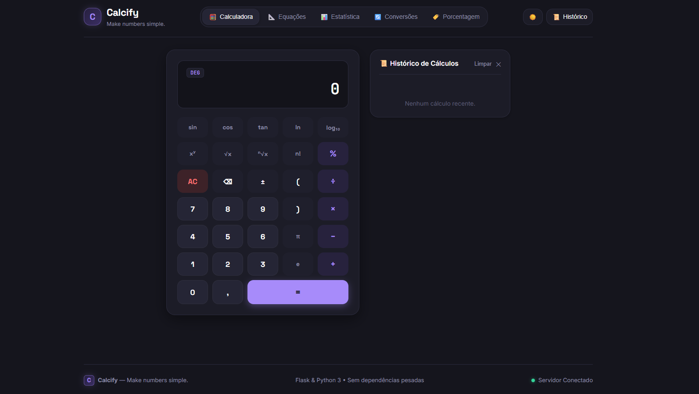

# Calcify — Calculadora Científica

**Make numbers simple.**

O Calcify é uma calculadora científica desenvolvida em Python que evoluiu de uma aplicação executada no terminal para uma aplicação web interativa. Reúne operações matemáticas, funções científicas, resolução de equações, estatística e conversões em uma única interface.

## 🌐 Acesse o projeto

**[Acessar o Calcify](https://calcify-calculadora-cient-fica-em-pythonv.onrender.com)**

Disponível online, diretamente pelo navegador, sem necessidade de instalação.

## 📸 Demonstração



*Interface da calculadora científica.*

## 💡 Sobre o projeto

O projeto começou como uma calculadora desenvolvida em Python, com o objetivo de praticar lógica de programação, funções e organização de código.

Durante o **Desafio 2 da Imersão Engenharia de Software: Dev na Era da IA**, promovida pela Alura em parceria com o Google, utilizei o Google Antigravity para explorar novas possibilidades de desenvolvimento com inteligência artificial.

A partir dessa experiência, decidi evoluir o projeto original, mantendo sua lógica matemática e transformando-o em uma aplicação web completa.

O resultado foi o Calcify, uma aplicação que integra Python, Flask, HTML, CSS e JavaScript, contando também com testes automatizados para validar seu funcionamento.

## ✨ Funcionalidades

- **Calculadora básica:** adição, subtração, multiplicação e divisão.
- **Porcentagem:** cálculo de porcentagem, aumento e desconto percentual.
- **Potenciação e radiciação:** potências, raízes quadradas e raízes de qualquer índice.
- **Funções científicas:** seno, cosseno, tangente, logaritmos e fatorial.
- **Equações:** resolução de equações de primeiro e segundo grau.
- **Estatística:** cálculo de média, mediana, maior e menor valor.
- **Conversões:** temperatura, distância e tempo.

### 🖥️ Recursos da interface

- Temas claro e escuro.
- Histórico de cálculos.
- Alternância entre graus e radianos.
- Suporte ao teclado.
- Interface responsiva.
- Comunicação entre frontend e backend por API.

## 🛠️ Tecnologias utilizadas

| Tecnologia | Aplicação |
|---|---|
| Python | Lógica matemática e backend |
| Flask | Aplicação web e API |
| HTML5 | Estrutura da interface |
| CSS3 | Estilização e responsividade |
| JavaScript | Interatividade e operações |
| Jinja2 | Integração dos templates |
| Unittest | Testes automatizados |
| Gunicorn | Servidor de produção |
| Google Antigravity | Ambiente de desenvolvimento com IA |

## 📂 Estrutura do projeto

```text
Calcify/
├── app.py
├── calculadora.py
├── operacoes.py
├── test_app.py
├── test_calculadora.py
├── requirements.txt
├── Procfile
├── render.yaml
├── README.md
├── templates/
│   └── index.html
└── static/
    ├── css/
    │   └── style.css
    └── js/
        └── main.js
```

## 🚀 Como executar localmente

### 1. Clone o repositório

```bash
git clone https://github.com/malucalauti12-prog/Calcify---Calculadora-Cient-fica-em-Pythonv.git
```

### 2. Entre na pasta do projeto

```bash
cd Calcify---Calculadora-Cient-fica-em-Pythonv
```

### 3. Instale as dependências

```bash
pip install -r requirements.txt
```

### 4. Inicie a aplicação web

```bash
python app.py
```

Acesse no navegador:

```text
http://localhost:5000
```

### Calculadora pelo terminal

O projeto também mantém sua versão original, executada diretamente pelo terminal:

```bash
python calculadora.py
```

## 🧪 Testes automatizados

O projeto possui **44 testes automatizados**, divididos em:

- 32 testes unitários para validar as operações matemáticas.
- 12 testes de integração para verificar a aplicação web e suas rotas.

Para executar os testes:

```bash
python -m unittest -v test_calculadora.py test_app.py
```

**Última execução registrada:** 44 testes executados e aprovados, sem falhas.

## ☁️ Publicação

A aplicação está hospedada na plataforma **Render**, utilizando Gunicorn como servidor de produção para executar o projeto Flask.

🔗 **Aplicação online:** [Calcify — Calculadora Científica](https://calcify-calculadora-cient-fica-em-pythonv.onrender.com)

## 🎯 Aprendizados e desenvolvimento

O desenvolvimento do Calcify foi uma oportunidade de transformar conhecimentos teóricos em uma aplicação prática.

Durante sua evolução, pude trabalhar com:

- Organização e reutilização de código.
- Integração entre frontend e backend.
- Criação e utilização de APIs.
- Desenvolvimento de interfaces web.
- Implementação de testes automatizados.
- Utilização de inteligência artificial como apoio ao desenvolvimento.

A inteligência artificial foi utilizada como ferramenta de apoio, enquanto as decisões, melhorias e validações fizeram parte do processo de aprendizado e evolução do projeto.

---

**Desenvolvido com Python, curiosidade e vontade de aprender.** ⭐

A experiência contribuiu para desenvolver minha capacidade de compreender códigos, identificar melhorias e validar soluções.

*Projeto desenvolvido para fins de aprendizado e prática de programação.*
